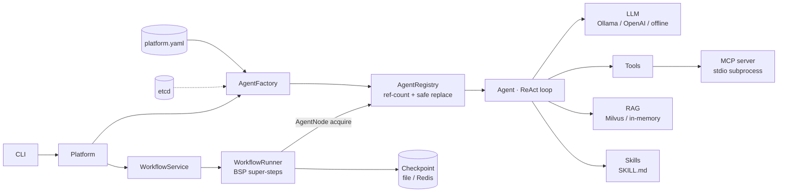

# BitGuide Multi-Agent Platform

A configuration-driven multi-agent platform written from scratch in Python 3.11 `asyncio`,
**without LangChain / LangGraph**. It includes a hand-written ReAct loop, tool calling, RAG,
MCP (JSON-RPC over stdio), a reference-counted agent registry, and a graph workflow engine with
parallel super-steps, checkpoints, and human-in-the-loop pause / resume.

配置驱动的多 Agent 平台：手写 ReAct 推理循环、工具调用、RAG 检索、MCP 协议接入、
带引用计数的 Agent 注册表，以及支持并行超步、断点恢复、人工审批的图式工作流引擎。
不依赖 LangChain / LangGraph，**没有大模型也能用 `--offline` 跑通全部流程**。



## Quick start

```bash
uv sync
uv run bitguide --offline agents                         # list agents
uv run bitguide --offline chat -m "周末带 4 岁孩子玩什么？顺便算 12*(3+4)"
uv run bitguide --offline workflow list                  # 8 demo workflows
uv run bitguide --offline workflow run expert_review -i "孩子想学编程" --thread demo
uv run bitguide --offline workflow resume demo --approve # resumes from checkpoint, even in a new process
```

With a real model: `ollama pull qwen2.5`, then drop `--offline`. To use a cloud model, add an
OpenAI-compatible entry under `models:` in `config/platform.yaml` (API key via `apiKeyEnv`).

## Highlights

| Area | What it does |
|---|---|
| ReAct agent | reason → tool call → observe loop, max-iteration guard, memory written only on success |
| Tools | exception-isolated `ToolManager`, AST-based safe calculator (no `eval`) |
| MCP | hand-written JSON-RPC 2.0 stdio client + server; remote tools adapted to the local `Tool` protocol |
| RAG | boundary-aware splitter with overlap, pluggable embedder / vector store (Milvus or in-memory), fail-open |
| Registry | `async with registry.acquire(id)`; `replace()` swaps instances atomically and retires the old one only after in-flight requests finish |
| Factory | turns YAML / etcd declarations into live agents, cleans up partial resources on failure |
| Workflow engine | `Graph` + `Channel` (LastValue / Append / Ephemeral), BFS validation, BSP super-steps with `asyncio.gather` + `Semaphore` |
| Checkpoint & HITL | snapshot after every step; `Interrupt` pauses, `resume()` continues; failed nodes retried without re-running finished siblings |
| Demos | pipeline, router, parallel experts, review loop, supervisor, human approval, tool pipeline, expert review |

## Project layout

```
config/platform.yaml     models, agents, RAG, MCP, workflow settings
src/bitguide/
  models.py tools.py memory.py contracts.py agent.py   # single agent core
  llm.py config.py observability.py skills.py rag.py mcp.py
  infrastructure.py registry.py factory.py application.py cli.py
  workflow_core.py workflow_runtime.py workflow_checkpoint.py
  workflow_nodes.py workflow_registry.py workflow_demos.py workflow.py
mcp_servers/             a minimal MCP server (no SDK)
knowledge/  skills/      sample knowledge base and SKILL.md files
tests/                   177 tests, 93% coverage, no network needed
```

## Development

```bash
uv run pytest -q          # tests
uv run ruff check .       # lint
uv run pyright            # type check
uv sync --extra milvus    # optional: Milvus Lite vector store
uv sync --extra redis     # optional: Redis checkpoint store
```

License: for learning purposes. Rebuilt independently with reference to an open-source teaching
project.
