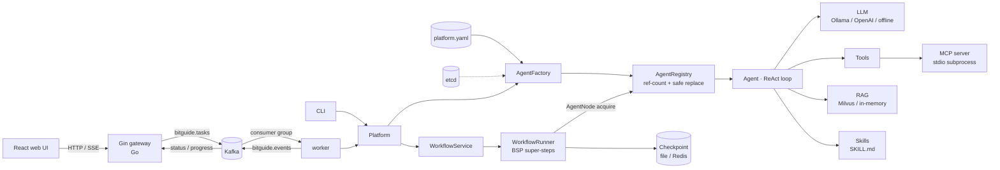

# BitGuide Multi-Agent Platform

A configuration-driven multi-agent platform written from scratch in Python 3.11 `asyncio`,
**without LangChain / LangGraph**. It includes a hand-written ReAct loop, tool calling, RAG,
MCP (JSON-RPC over stdio), a reference-counted agent registry, and a graph workflow engine with
parallel super-steps, checkpoints, and human-in-the-loop pause / resume.



## Quick start

```bash
uv sync
uv run bitguide --offline agents                         # list agents
uv run bitguide --offline chat -m "周末带 4 岁孩子玩什么？顺便算 12*(3+4)"
uv run bitguide --offline workflow list                  # 8 demo workflows
uv run bitguide --offline workflow run expert_review -i "孩子想学编程" --thread demo
uv run bitguide --offline workflow resume demo --approve # resumes from checkpoint, even in a new process
```

With a real model: `ollama pull qwen2.5`, then drop `--offline`. To use a cloud model, add an
OpenAI-compatible entry under `models:` in `config/platform.yaml` (API key via `apiKeyEnv`).

## Web UI, gateway and workers

```
browser ──HTTP──► Gin gateway ──bitguide.tasks──► Python workers (consumer group)
browser ◄──SSE─── Gin gateway ◄─bitguide.events── Python workers
                      │
                    Redis (task state, written only by the gateway)
```

- **Two Kafka topics, keyed by task id**, so all messages of one task land on one partition and
  stay in order (its `run` is always handled before its `resume`).
- **Workers** (`bitguide worker`) join the `bitguide-workers` consumer group; partitions are spread
  over consumers, so starting more processes scales out.
- **At-least-once + idempotent:** a worker commits the offset only after the workflow finished and
  its events were sent, so a crash means redelivery. Before running, it checks the workflow
  checkpoint and skips messages that were already handled.
- **Events back to Go:** `status` events (running / interrupted / completed / failed) update Redis;
  `progress` events (each workflow step and node) are forwarded to the browser over SSE.

```bash
redis-server                                     # localhost:6379
brew install kafka && brew services start kafka  # localhost:9092
kafka-topics --bootstrap-server localhost:9092 --create --topic bitguide.tasks --partitions 3
kafka-topics --bootstrap-server localhost:9092 --create --topic bitguide.events --partitions 3

uv sync --extra kafka
uv run bitguide --offline worker                 # --concurrency 3 consumers (≤ partitions)
cd gateway && go run .                           # :8080 (env ADDR, REDIS_ADDR, KAFKA_BROKERS)
cd web && npm install && npm run dev             # http://localhost:5173
```

The web UI has three pages: submit a task, task list, and task detail. The detail page opens an
`EventSource` on `GET /tasks/:id/events` (a `snapshot` first, then live events) and shows approve
/ reject buttons while the workflow waits for approval.

| Endpoint | |
|---|---|
| `POST /tasks` `{"workflow","input"}` | `202 {"id"}` |
| `GET /tasks` · `GET /tasks/:id` | latest 50 tasks · one task |
| `POST /tasks/:id/resume` `{"approved","comment"}` | only for `interrupted` (decision required) or `failed` (retry), else `409` |
| `GET /tasks/:id/events` | SSE stream |

## Highlights

| Area | What it does |
|---|---|
| ReAct agent | reason → tool call → observe loop, max-iteration guard, memory written only on success |
| Tools | exception-isolated `ToolManager`, AST-based safe calculator (no `eval`) |
| MCP | hand-written JSON-RPC 2.0 stdio client + server; remote tools adapted to the local `Tool` protocol |
| RAG | boundary-aware splitter with overlap, pluggable embedder / vector store (Milvus or in-memory), fail-open |
| Registry | `async with registry.acquire(id)`; `replace()` swaps instances atomically and retires the old one only after in-flight requests finish |
| Factory | turns YAML / etcd declarations into live agents, cleans up partial resources on failure |
| Workflow engine | `Graph` + `Channel` (LastValue / Append / Ephemeral), BFS validation, BSP super-steps with `asyncio.gather` + `Semaphore` |
| Checkpoint & HITL | snapshot after every step; `Interrupt` pauses, `resume()` continues; failed nodes retried without re-running finished siblings |
| Demos | pipeline, router, parallel experts, review loop, supervisor, human approval, tool pipeline, expert review |

## Project layout

```
config/platform.yaml     models, agents, RAG, MCP, workflow settings
gateway/                 Gin gateway: task API (tasks.go), Kafka events + SSE (events.go),
                         GORM models for task history (store/, not wired in yet)
web/                     Vite + React + TypeScript UI: submit, list, live detail with approval
src/bitguide/
  models.py tools.py memory.py contracts.py agent.py   # single agent core
  llm.py config.py observability.py skills.py rag.py mcp.py
  infrastructure.py registry.py factory.py application.py cli.py
  workflow_core.py workflow_runtime.py workflow_checkpoint.py
  workflow_nodes.py workflow_registry.py workflow_demos.py workflow.py
  worker.py                                            # Kafka worker: run tasks, send events back
mcp_servers/             a minimal MCP server (no SDK)
knowledge/  skills/      sample knowledge base and SKILL.md files
tests/                   180 tests, 93% coverage, no network needed
```

## Development

```bash
uv run pytest -q          # tests
uv run ruff check .       # lint
uv run pyright            # type check
uv sync --extra milvus    # optional: Milvus Lite vector store
uv sync --extra redis     # optional: Redis checkpoint store
uv sync --extra kafka     # optional: Kafka task worker
```

License: for learning purposes. Rebuilt independently with reference to an open-source teaching
project.
